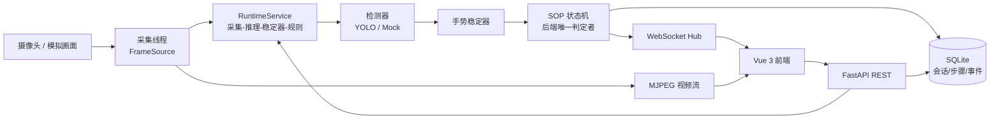
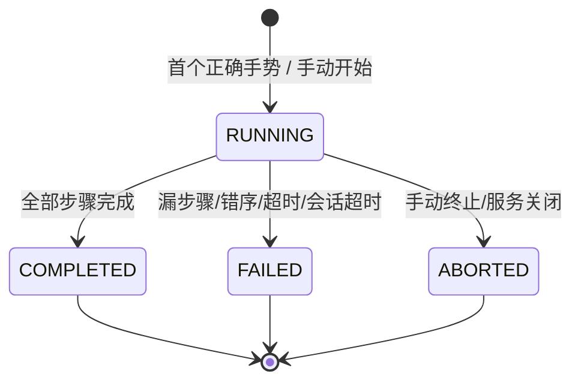

# 工业 AI SOP 智能监控系统（v2）


前后端分离的工业 SOP 监控与合规判定系统。前端使用 Vue 3 + TypeScript + Vite + Element Plus，后端使用 FastAPI + SQLite + WebSocket，并预留/集成了 Ultralytics YOLO 推理接口。

> **重要声明**
>
> - 当前仓库**不包含训练好的 YOLO 权重**。未放置权重时，后端会明确进入「模拟检测器」模式，界面显示 `SIMULATION`，不会把模拟结果伪装成真实 AI 识别。
> - 没有虚构模型准确率、工业测试数据或产线结论。
> - 本系统不控制真实设备或 PLC，仅做流程监控与规则判定。
> - SOP 是否合规**只由后端规则引擎判定**，前端只展示结果。

---

## 0. 一分钟启动 / 关闭（Windows）

所有命令都在项目根目录执行：

```text
E:\Python\CV+AI+SOP+Study + v2
```

### 0.1 最快方式：双击批处理

| 操作 | 双击文件 | 等价命令（PowerShell / CMD） |
| --- | --- | --- |
| 首次安装依赖 | `install.bat` | `powershell -NoProfile -ExecutionPolicy Bypass -File .\scripts\install.ps1` |
| **启动前端 + 后端** | **`start-all.bat`** | `powershell -NoProfile -ExecutionPolicy Bypass -File .\scripts\start-all.ps1` |
| **停止前端 + 后端** | **`stop-all.bat`** | `powershell -NoProfile -ExecutionPolicy Bypass -File .\scripts\stop-all.ps1` |
| 查看运行状态 | `status.bat` | `powershell -NoProfile -ExecutionPolicy Bypass -File .\scripts\status.ps1` |
| 只启动后端 | `start-backend.bat` | `powershell -NoProfile -ExecutionPolicy Bypass -File .\scripts\start-backend.ps1` |
| 只启动前端 | `start-frontend.bat` | `powershell -NoProfile -ExecutionPolicy Bypass -File .\scripts\start-frontend.ps1` |
| 只停止后端 | `stop-backend.bat` | `powershell -NoProfile -ExecutionPolicy Bypass -File .\scripts\stop-backend.ps1` |
| 只停止前端 | `stop-frontend.bat` | `powershell -NoProfile -ExecutionPolicy Bypass -File .\scripts\stop-frontend.ps1` |

启动成功后访问：

- **后端控制台（后端自己托管的页面）**：<http://127.0.0.1:8000/> 或 <http://127.0.0.1:8000/console>
- 前端（Vue）：<http://127.0.0.1:5173/>
- 后端 API 文档：<http://127.0.0.1:8000/docs>
- 健康检查：<http://127.0.0.1:8000/api/v1/health>

脚本会：

1. 自动使用项目内 `.venv` 的 Python；
2. 自动使用系统 `node`，若没有则回落到项目内 `.tools\node\node.exe`；
3. 检查端口是否已提供服务，已运行则不重复启动；
4. 将 PID 写入 `.run\backend.pid` / `.run\frontend.pid`；
5. 将日志写入 `logs\`。

### 0.2 分开启动（推荐开发调试，前台看日志）

#### 启动后端

```powershell
cd "E:\Python\CV+AI+SOP+Study + v2\backend"
..\.venv\Scripts\python.exe -m uvicorn app.main:app --host 127.0.0.1 --port 8000 --reload
```

等价写法（在项目根目录）：

```powershell
cd "E:\Python\CV+AI+SOP+Study + v2"
.\.venv\Scripts\python.exe -m uvicorn app.main:app --app-dir backend --host 127.0.0.1 --port 8000 --reload
```

- 停止：在该终端按 `Ctrl+C`，或双击 `stop-backend.bat`。
- 生产环境不要加 `--reload`，建议单 worker（运行时有内存状态）。

#### 启动前端

```powershell
cd "E:\Python\CV+AI+SOP+Study + v2\frontend"
..\.tools\node\npm.cmd install     # 首次或依赖变化时执行
..\.tools\node\npm.cmd run dev
```

如果系统已安装 Node.js（`node -v` 能输出版本），也可直接：

```powershell
cd "E:\Python\CV+AI+SOP+Study + v2\frontend"
npm install
npm run dev
```

- 停止：在该终端按 `Ctrl+C`，或双击 `stop-frontend.bat`。
- Vite 固定端口 `5173`，`/api` 已代理到 `http://127.0.0.1:8000`（含 WebSocket）。

### 0.3 本机环境注意事项（常见启动失败原因）

1. **本机没有全局 Node.js**
   - `node` / `npm` 在 PATH 中不存在。
   - 项目内已放置便携版 Node：`.tools\node\node.exe`。
   - 启动脚本会自动使用它；手动启动时请用 `..\.tools\node\npm.cmd`。

2. **PowerShell 禁止运行 `npm.ps1`**
   - 报错：`无法加载文件 ...\npm.ps1，因为在此系统上禁止运行脚本`。
   - 解决：使用 `npm.cmd`（推荐），或运行 `.bat` 脚本。
   - 不要为了启动项目随意改系统执行策略；如确需修改，请自行评估：
     `Set-ExecutionPolicy -Scope CurrentUser RemoteSigned`。

3. **端口被占用 / 重复启动**
   - 后端 `8000`、前端 `5173`。
   - **如果服务已经在运行，再次启动会失败**（Uvicorn 端口绑定失败、Vite `strictPort` 退出）。这不是环境损坏。
   - 正确做法：先执行 `stop-all.bat`，再 `start-all.bat`；或先 `status.bat` 确认。
   - 关闭 `start-all.bat` 的窗口**不会**停止后台服务，必须执行 `stop-all.bat`。
   - 检查端口：
     ```powershell
     Get-NetTCPConnection -LocalPort 8000,5173 -State Listen |
       Select-Object LocalPort,OwningProcess
     ```
   - 强制结束某个 PID（确认是本项目进程后再执行）：
     ```powershell
     taskkill /PID <PID> /T /F
     ```

4. **Python 不是 `python` 命令**
   - 本机可能是 `py -3`。虚拟环境已存在时直接使用 `.venv\Scripts\python.exe` 最稳妥。

5. **依赖缺失（ModuleNotFoundError）**
   - 不要用全局 Python 启动；先运行 `install.bat`，再使用 `.venv` 中的 Python。

### 0.4 启动验证清单

1. 双击 `status.bat`，应看到 `Backend : running` 与 `Frontend : running`；
2. 打开 <http://127.0.0.1:5173/>，右上角应显示「后端在线 / 实时已连接」；
3. 打开 <http://127.0.0.1:8000/api/v1/health>，返回 `"code": 0`；
4. 打开「系统状态」页，确认模型状态（当前无权重时为「模拟检测器」）与摄像头状态；
5. 若失败，查看 `logs\backend.err.log` 与 `logs\frontend.err.log`。

> 当前仓库默认没有 YOLO 权重，因此检测器为 `MOCK`（界面有 `SIMULATION` 标识）；摄像头可用时为真实画面。

### 0.5 日志位置

| 文件 | 内容 |
| --- | --- |
| `logs\backend.log` | 后端应用日志（轮转，含请求与规则事件） |
| `logs\backend.out.log` | 脚本启动后端的 stdout |
| `logs\backend.err.log` | 脚本启动后端的 stderr（uvicorn 输出） |
| `logs\frontend.out.log` | Vite 输出 |
| `logs\frontend.err.log` | Vite 错误输出 |

### 0.6 后端页面在哪里？

后端有**自己托管的页面**，不需要 Vue 构建：

- 后端控制台：<http://127.0.0.1:8000/> 或 <http://127.0.0.1:8000/console>；
- 页面文件：`backend\app\static\console.html`，由 FastAPI 直接返回；
- 页面无外部 CDN 依赖，离线也能打开；
- 可查看：服务信息、SOP 执行、当前会话、识别结果、模型/摄像头、最近错误日志；
- 可直接操作：开始/终止会话、重载模型、重连摄像头；
- 可跳转：Swagger 文档、OpenAPI、Vue 前端、健康检查。

后端代码在 `backend\app\`，入口 `backend\app\main.py`；前端在 `frontend\`，监听 `http://127.0.0.1:5173`，通过 Vite 把 `/api` 代理到后端。`start-all.bat` 会隐藏后端终端窗口，因此在任务栏里看不到后端日志窗口，但服务仍在运行。

验证后端确实存在且在工作：

```powershell
# 1) 查看进程与端口（Backend 必须是 running）
status.bat

# 2) 后端健康检查（浏览器打开，或看 JSON）
http://127.0.0.1:8000/api/v1/health

# 3) 后端接口文档（Swagger UI，能看到全部接口）
http://127.0.0.1:8000/docs

# 4) 后端源码目录
E:\Python\CV+AI+SOP+Study + v2\backend\app
```

如果停掉后端，前端顶部会立刻变成「后端离线 / 实时断开」，页面也无法加载数据；这可以反向确认数据来自后端，而不是前端写死的。

如果你希望**看到后端实时日志的前台窗口**，不要用 `start-all.bat`，改用：

```powershell
cd "E:\Python\CV+AI+SOP+Study + v2\backend"
..\.venv\Scripts\python.exe -m uvicorn app.main:app --host 127.0.0.1 --port 8000
```

---

## 1. 功能

| 模块 | 说明 |
| --- | --- |
| 首页仪表盘 | 当前工位、运行状态、今日操作次数、合规率、异常数量、最近异常/会话 |
| 实时监控 | MJPEG 画面、识别动作、置信度、当前 SOP 步骤、倒计时、合规状态、实时事件 |
| SOP 配置 | 步骤名称、顺序、手势、超时、启用/必做、说明；运行中修改下一会话生效 |
| 规则引擎 | 顺序、漏步骤、重复步骤、错误顺序、步骤超时、会话超时、手动终止、完成判定 |
| 异常记录 | 时间、工位、类型、级别、当前步骤、描述、确认/解决、筛选与分页 |
| 历史记录 | 会话查询、完成情况、合规结果、步骤耗时、异常明细 |
| 系统状态 | 后端/模型/摄像头/数据库/实时通道、最近错误日志、运行配置、模型重载与摄像头重连 |
| 后端控制台 | 后端自托管页面（`/console`），展示服务与 SOP 状态并支持会话/模型/摄像头操作 |
| 模拟演示 | 仅在模拟检测器下可注入手势或漏步骤/重复/错序/超时场景，用于验证规则 |

---

## 2. 技术栈与目录

### 技术栈

- 前端：Vue 3、TypeScript、Vite、Vue Router、Pinia、Element Plus、Axios
- 后端：Python 3.13、FastAPI、Pydantic v2、Uvicorn
- 数据库：SQLite（WAL）
- 实时通信：WebSocket（遥测/事件）+ MJPEG（视频）
- AI：Ultralytics YOLO（可选权重）、OpenCV 采集
- 测试：pytest + httpx/TestClient

### 目录结构

```text
v2/
├─ backend/
│  ├─ app/
│  │  ├─ main.py                 # FastAPI 入口、中间件、异常处理
│  │  ├─ core/                   # 配置、日志、异常、统一响应、依赖容器
│  │  ├─ api/v1/                 # REST + WebSocket 路由
│  │  ├─ schemas/                # HTTP 请求/响应 Schema
│  │  ├─ domain/                 # 领域枚举与数据对象
│  │  ├─ db/                     # SQLite、schema.sql、仓储
│  │  ├─ services/               # SOP 状态机、运行时、摄像头、稳定器、推送
│  │  └─ inference/              # 检测器接口、YOLO、模拟检测器、工厂
│  ├─ tests/                     # pytest
│  ├─ requirements.txt           # 含 ultralytics/torch
│  ├─ requirements-lite.txt      # 不含 ultralytics
│  ├─ .env.example
│  └─ pytest.ini
├─ frontend/
│  ├─ src/
│  │  ├─ api/                    # Axios 封装与接口
│  │  ├─ layouts/                # 工业风侧边栏布局
│  │  ├─ stores/                 # Pinia：系统状态、实时监控
│  │  ├─ views/                  # 六个页面
│  │  ├─ router/                 # 路由
│  │  ├─ types/                  # TypeScript 类型
│  │  └─ styles/
│  ├─ vite.config.ts             # /api 代理（含 WS）
│  └─ package.json
├─ models/
│  ├─ class_map.json             # YOLO 类别名 -> ONE..FIVE
│  └─ weights/                   # 放置 .pt 权重（不入库）
├─ data/                         # SQLite 数据库
├─ logs/                         # 运行日志
├─ scripts/                      # 启动/停止/安装/状态脚本
├─ .run/                         # PID 文件（运行时生成）
├─ .tools/                       # 便携 Node（本机，不入库）
├─ install.bat / start-all.bat / stop-all.bat / status.bat
└─ README.md
```

---

## 3. 架构



分层职责：

- `api`：只做参数校验、调用服务、统一响应。
- `services`：状态机、运行时编排、采集、推送。
- `inference`：可插拔检测器，不依赖业务逻辑。
- `db`：SQLite 与仓储，不依赖 FastAPI。
- `frontend`：展示与操作，不参与合规判定。

---

## 4. 配置（环境变量）

复制 `backend\.env.example` 为 `backend\.env` 后修改。所有变量前缀为 `SOP_`。

| 变量 | 默认值 | 说明 |
| --- | --- | --- |
| `SOP_HOST` / `SOP_PORT` | `127.0.0.1` / `8000` | 后端监听地址 |
| `SOP_CORS_ORIGINS` | `http://localhost:5173,http://127.0.0.1:5173` | 允许的前端来源 |
| `SOP_STATION_ID` / `SOP_STATION_NAME` | `WS-01` / `装配工位 A` | 工位 |
| `SOP_INFERENCE_MODE` | `auto` | `auto` / `yolo` / `mock` |
| `SOP_MODEL_PATH` | `models/weights/gesture_yolo.pt` | 权重路径 |
| `SOP_MODEL_CLASS_MAP` | `models/class_map.json` | 类别映射 |
| `SOP_MODEL_DEVICE` | `cpu` | `cpu` / `cuda:0` 等 |
| `SOP_MODEL_CONF` / `SOP_MODEL_IOU` | `0.45` / `0.50` | 推理阈值 |
| `SOP_CAMERA_MODE` | `auto` | `auto` / `device` / `synthetic` / `off` |
| `SOP_CAMERA_INDEX` | `0` | 摄像头索引 |
| `SOP_INFERENCE_FPS` | `5` | 推理频率 |
| `SOP_DETECTION_STABLE_FRAMES` | `3` | 连续稳定帧数 |
| `SOP_DETECTION_RESET_MS` | `500` | 手势中断重置时间 |
| `SOP_MOCK_SCENARIO` | `clean` | `clean` / `faulty` |
| `SOP_FAIL_ON_SEQUENCE_ERROR` | `true` | 错序/漏步骤是否立即失败 |
| `SOP_FAIL_ON_TIMEOUT` | `true` | 步骤超时是否立即失败 |
| `SOP_SESSION_MAX_SECONDS` | `300` | 单会话最大时长 |
| `SOP_AUTO_START_SESSION` | `true` | 首个正确动作自动开始会话 |
| `SOP_RUNTIME_ENABLED` | `true` | 关闭后不启动采集/推理循环（测试用） |

修改 `.env` 后需重启后端。

---

## 5. 模拟模式与真实 YOLO

### 5.1 当前默认行为

- `SOP_INFERENCE_MODE=auto`
- 若 `models/weights/gesture_yolo.pt` 不存在：
  - 检测器状态为 `MOCK`；
  - 所有检测结果 `simulated=true`；
  - 前端显示 `SIMULATION`、`模拟检测（非真实 AI）`；
  - 系统状态页明确给出降级原因。
- 摄像头 `auto`：优先真实摄像头，失败则切换为带水印的模拟画面（`SIMULATED CAMERA FEED`）。

### 5.2 接入真实 YOLO

1. 训练 5 类手势检测模型（类别对应 `ONE..FIVE`）。
2. 将权重放到 `models/weights/gesture_yolo.pt`，或修改 `SOP_MODEL_PATH`。
3. 按实际类别名修改 `models/class_map.json`：

   ```json
   {
     "classes": {
       "one": "ONE",
       "two": "TWO",
       "three": "THREE",
       "four": "FOUR",
       "five": "FIVE"
     }
   }
   ```

4. 确保已安装 `ultralytics`（`requirements.txt` 已包含）。
5. 重启后端，或在「系统状态」页点击「重新加载模型」。
6. 系统状态页应显示 `READY`、`simulated=false`，前端不再显示模拟检测标识。

> 若模型类别无法映射到 `ONE..FIVE`，检测器状态会变为 `ERROR` 并给出类别示例，不会静默伪造结果。

### 5.3 模拟注入限制

「规则演示」仅在检测器为模拟模式时可用。真实 YOLO 模式下后端返回 `409`，前端隐藏注入入口。

---

## 6. SOP 规则



规则细节：

- 只接受**当前步骤**对应的手势。
- 检测到**后续步骤**手势：记录 `SKIPPED_STEP` + `ORDER_ERROR`；必做步骤且 `fail_on_sequence_error=true` 时会话失败。
- 重复已完成步骤：记录 `REPEATED_STEP`（WARNING），不推进流程。
- 步骤计时超过 `timeout_seconds`：记录 `STEP_TIMEOUT`；`fail_on_timeout=true` 时会话失败。
- 会话超过 `session_max_seconds`：`SESSION_TIMEOUT`。
- 手动终止：`SESSION_ABORTED`。
- **合规 = 会话状态为 `COMPLETED` 且异常数为 0**。
- 会话结束后需要手势释放（画面中短暂无手势），才允许下一次自动开始，避免同一手势连续触发多个会话。
- 自动开始仅接受第一步手势；若操作员先做后续动作，不会创建会话（手动开始则会按错序记录）。

默认五步：

| 顺序 | 名称 | 手势 | 超时 |
| --- | --- | --- | --- |
| 1 | 举起 1 根手指 | ONE | 20s |
| 2 | 举起 2 根手指 | TWO | 20s |
| 3 | 举起 3 根手指 | THREE | 25s |
| 4 | 举起 4 根手指 | FOUR | 30s |
| 5 | 举起 5 根手指 | FIVE | 20s |

---

## 7. REST API（前缀 `/api/v1`）

后端根路径 `/` 与 `/console` 返回后端控制台 HTML 页面（非 JSON）。其余业务接口均在 `/api/v1` 下。

统一响应：

```json
{
  "code": 0,
  "message": "ok",
  "data": {},
  "request_id": "ab12cd34ef56",
  "timestamp": "2026-10-24T17:00:00+08:00"
}
```

| 方法 | 路径 | 说明 |
| --- | --- | --- |
| GET | `/health` | 健康与组件状态 |
| GET | `/health/live` | 存活探针 |
| GET | `/health/ready` | 就绪探针（数据库等） |
| GET | `/dashboard/summary` | 仪表盘聚合 |
| GET | `/monitor/current` | 当前监控快照 |
| GET | `/monitor/frame` | 单帧 JPEG |
| GET | `/monitor/stream` | MJPEG 视频流 |
| POST | `/monitor/session/start` | 手动开始会话 |
| POST | `/monitor/session/stop` | 手动终止会话（body: `{"reason": "..."}`） |
| GET | `/sop/steps` | SOP 步骤配置 |
| PUT | `/sop/steps` | 保存配置（运行中下一会话生效） |
| POST | `/sop/steps/reset` | 恢复默认五步 |
| GET | `/events` | 异常列表（分页/筛选/`include_info`） |
| POST | `/events/{id}/status` | 确认/解决（`ACKED` / `RESOLVED`） |
| GET | `/history/sessions` | 历史会话（分页/筛选） |
| GET | `/history/sessions/{id}` | 会话详情（步骤 + 事件） |
| GET | `/system/status` | 系统完整状态 |
| GET | `/system/config` | 安全配置摘要 |
| GET | `/system/logs` | 最近 WARNING+ 日志 |
| POST | `/system/model/reload` | 重新加载模型 |
| POST | `/system/camera/reconnect` | 重连摄像头 |
| POST | `/system/simulation` | 模拟注入（仅模拟模式） |

错误响应示例：

```json
{
  "code": 40900,
  "message": "当前没有运行中的会话",
  "data": null,
  "request_id": "9f8e7d6c5b4a",
  "timestamp": "2026-10-24T17:00:00+08:00"
}
```

---

## 8. WebSocket

- 地址：`ws://127.0.0.1:5173/api/v1/ws/monitor`（经 Vite 代理）
- 或直连：`ws://127.0.0.1:8000/api/v1/ws/monitor`

消息类型：

| 类型 | 说明 |
| --- | --- |
| `hello` | 连接建立，包含系统状态与监控快照 |
| `telemetry` | 约 300ms 一次监控快照（检测、步骤、会话、状态） |
| `event` | 新异常/流程事件 |
| `session` | 会话开始/结束 |
| `system` | 系统状态变化（模型/摄像头/配置） |
| `pong` | 心跳响应 |

客户端可发送 `{"type":"ping"}`。

前端在 WS 断开时自动降级为 2.5 秒轮询，并在顶部显示「实时断开」。

---

## 9. 数据库

SQLite 文件：`data/sop.db`（WAL 模式，自动创建）。

| 表 | 说明 |
| --- | --- |
| `sop_steps` | 步骤配置 |
| `sop_sessions` | 会话（状态、时间、步骤数、异常数、合规） |
| `sop_step_records` | 步骤执行明细（完成/超时/跳过、耗时、置信度） |
| `sop_events` | 异常与流程事件（级别、处理状态、处理时间） |

服务重启时，遗留的 `RUNNING` 会话会自动标记为 `ABORTED` 并写入日志。

---

## 10. 测试与构建

后端测试：

```powershell
cd "E:\Python\CV+AI+SOP+Study + v2\backend"
..\.venv\Scripts\python.exe -m pytest -q
```

前端类型检查与构建：

```powershell
cd "E:\Python\CV+AI+SOP+Study + v2\frontend"
..\.tools\node\npm.cmd run build
```

仅类型检查：

```powershell
..\.tools\node\npm.cmd run typecheck
```

---

## 11. 部署提示

- 前端 `npm run build` 生成 `frontend/dist`，由 Nginx 等静态服务器托管。
- 后端使用单 worker：
  ```powershell
  .\.venv\Scripts\python.exe -m uvicorn app.main:app --host 0.0.0.0 --port 8000
  ```
  原因：采集线程、SOP 会话与 WebSocket 连接保存在进程内存中，多 worker 会状态分裂。
- Nginx 需同时代理 `/api` 与 WebSocket（`Upgrade` / `Connection`）。
- 生产环境建议：
  - 设置 `SOP_ENV=prod`；
  - 限制 `SOP_CORS_ORIGINS`；
  - 将 `logs/`、`data/` 放到持久化目录；
  - 为 FastAPI 增加鉴权与 HTTPS（当前阶段未实现用户体系）。

---

## 12. 常见问题排查

### 12.1 前后端都启动不了

按顺序执行：

```powershell
cd "E:\Python\CV+AI+SOP+Study + v2"
powershell -NoProfile -ExecutionPolicy Bypass -File .\scripts\stop-all.ps1
powershell -NoProfile -ExecutionPolicy Bypass -File .\scripts\install.ps1
powershell -NoProfile -ExecutionPolicy Bypass -File .\scripts\start-all.ps1
powershell -NoProfile -ExecutionPolicy Bypass -File .\scripts\status.ps1
```

仍失败时检查：

1. `logs\backend.err.log`、`logs\backend.log`；
2. `logs\frontend.err.log`、`logs\frontend.out.log`；
3. 端口是否被其他程序占用；
4. `.venv\Scripts\python.exe` 是否存在；
5. Node 是否可用（或 `.tools\node` 是否存在）。

### 12.2 端口占用

```powershell
Get-NetTCPConnection -LocalPort 8000,5173 -State Listen |
  Select-Object LocalPort,OwningProcess
Get-CimInstance Win32_Process -Filter "ProcessId = <PID>" |
  Select-Object ProcessId,Name,CommandLine
```

确认是本项目后可用 `stop-backend.bat` / `stop-frontend.bat`，或 `taskkill /PID <PID> /T /F`。

### 12.3 打开前端但不能启动

- 不要直接在浏览器中打开 `index.html`，必须通过 Vite：`npm run dev` / `start-frontend.bat`。
- 端口必须是 `5173`，否则 `/api` 代理不可用。

### 12.4 前端提示「无法连接后端服务」

- 打开 <http://127.0.0.1:8000/api/v1/health> 确认后端；
- 确认前端由 Vite 代理启动（`/api` 指向 `127.0.0.1:8000`）；
- 检查 `backend\.env` 的 `SOP_CORS_ORIGINS`。

### 12.5 模型加载失败

- 检查 `models\weights\gesture_yolo.pt` 是否存在；
- 检查 `models\class_map.json` 是否覆盖模型实际类别名；
- 查看「系统状态」页的错误与 `logs\backend.log`；
- 先切回 `SOP_INFERENCE_MODE=mock` 验证前后端，再排查权重。

### 12.6 摄像头打不开 / 被占用

- 关闭其他使用摄像头的软件；
- 修改 `SOP_CAMERA_INDEX`；
- 或设置 `SOP_CAMERA_MODE=synthetic`（明确水印的模拟画面）；
- 点击系统状态页「重连摄像头」。

### 12.7 合规率一直是 0% 或没有新会话

- 模拟检测器需要从第一步手势开始才会自动开会话；
- 若上一次会话刚结束，需要等手势释放后再做第一个动作；
- 可在监控页手动「开始新会话」，再注入手势/做动作；
- 使用「规则演示」生成异常后，合规率会下降，这是预期行为。

---

## 13. 开发阶段状态

| 阶段 | 内容 | 状态 |
| --- | --- | --- |
| 第一阶段 | 前后端基础结构、健康检查、接口连通 | 已完成 |
| 第二阶段 | 六个前端页面、路由、仪表盘、监控、异常、SOP 配置 | 已完成 |
| 第三阶段 | 后端 SOP 状态机、SQLite 持久化 | 已完成 |
| 第四阶段 | WebSocket 实时推送、前后端联调 | 已完成 |
| 第五阶段 | YOLO 检测器接口与模型加载 | 已完成（等待真实权重） |
| 第六阶段 | 测试、运行文档、错误处理、启停脚本 | 已完成 |

### 已知限制

- 尚无用户登录、权限与审计账号体系。
- 尚未接入真实工业相机 RTSP/GB28181，仅使用 OpenCV 设备或模拟画面。
- 未做多工位并发调度（当前单工位实例）。
- 未接入 PLC/MES，仅做监控与记录。
- 模型权重需自行训练与部署；仓库不提供虚构精度数据。
